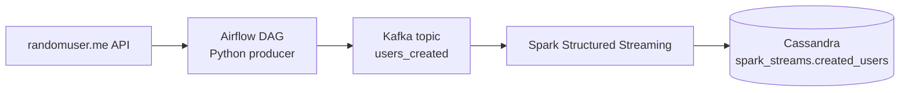

# Real-Time Data Streaming Pipeline

An end-to-end data engineering project that pulls random user profiles from a public API, streams them through Kafka, processes them with Spark Structured Streaming, and stores them in Cassandra. Airflow orchestrates the ingestion and Docker runs the infrastructure.



> Built while following the "Realtime Data Streaming | End To End Data Engineering Project" tutorial by CodeWithYu, then debugged, adapted and documented on my own setup (Windows, 8 GB RAM).

---

## What each component does

| Layer | Tool | Role in this project |
|---|---|---|
| Source | [randomuser.me](https://randomuser.me/) API | Returns one random user profile per request |
| Orchestration | Apache Airflow 2.6 | Runs the DAG that fetches, cleans and streams data to Kafka |
| Messaging | Apache Kafka (Confluent 7.4) + Zookeeper | Buffers the messages between producer and consumer |
| Processing | Apache Spark 3.4 (PySpark) | Reads from Kafka, applies a schema, writes to Cassandra |
| Storage | Apache Cassandra 4.1 | Final store for the user records |
| Infrastructure | Docker Compose | Runs Kafka, Zookeeper, Airflow, Postgres and Cassandra |

Airflow also needs a metadata database, which is the Postgres container. It does not store any of the project data.

---

## How it works

### 1. Ingestion (`dags/kafka_streaming.py`)
The DAG `user_automation` has one task, `streaming_data_from_api`, scheduled with `@daily`. Each run:

1. `get_data()` calls the randomuser.me API and returns one user.
2. `format_data()` keeps only the fields we need, builds a dictionary, and adds a UUID as `id`.
3. `streaming_data()` creates a `KafkaProducer` and repeats steps 1 and 2 in a loop for **60 seconds**, sending each record to the `users_created` topic as UTF-8 encoded JSON bytes.

Errors inside the loop are logged with `logging.error` so one failed request does not stop the stream.

### 2. Processing and storage (`spark_stream.py`)
The script runs on the host machine and does the following:

1. Starts a `SparkSession` with the Cassandra and Kafka connector packages.
2. Reads the `users_created` topic with `readStream`, starting from the earliest offset.
3. Casts the Kafka `value` column from bytes to a string, parses it with `from_json` using an explicit schema, and flattens it into columns.
4. Uses the Cassandra Python driver to create the keyspace `spark_streams` and the table `created_users` if they do not exist.
5. Starts `writeStream` into Cassandra. Nothing flows until this step, because Spark is lazy and only starts executing at `.start()`.

### Cassandra table

| Column | Type | Notes |
|---|---|---|
| `id` | UUID | Primary key, generated in `format_data()` |
| `first_name`, `last_name` | TEXT | |
| `gender` | TEXT | |
| `address` | TEXT | Street, city, state, country combined |
| `post_code` | TEXT | |
| `email`, `username` | TEXT | |
| `registered_date` | TEXT | |
| `phone`, `picture` | TEXT | Picture is a URL |

Field names must match exactly across the producer, the Spark schema and the Cassandra table.

---

## Project structure

```
.
├── dags/
│   └── kafka_streaming.py      # Airflow DAG + Kafka producer
├── spark_stream.py             # Spark job: Kafka -> Cassandra
├── docker-compose.yaml         # Kafka, Zookeeper, Airflow, Postgres, Cassandra
├── requirements.txt            # Python packages installed in the Airflow containers
└── README.md
```

---

## Prerequisites

- Docker Desktop, with at least 4 GB of memory available to it
- Python 3.11 (the Cassandra driver breaks on 3.12 because `asyncore` was removed)
- Java 11 (Spark 3.4 does not work with newer Java versions)
- Python packages for the Spark script:
  ```bash
  pip install pyspark==3.4.1 cassandra-driver
  ```
- **Windows only:** `winutils.exe` and `hadoop.dll` (Hadoop 3.2.0 build) placed in `C:\hadoop\bin`, with `HADOOP_HOME=C:\hadoop`

---

## How to run

**1. Start the infrastructure**
```bash
docker-compose up -d
docker ps
```
Wait until `broker` and `webserver` show `healthy` and `cassandra` and `scheduler` are `Up`. The first start can take several minutes.

**2. Trigger the DAG**

1. Open http://localhost:8080 and log in with `admin` / `admin`.
2. Unpause the `user_automation` DAG (toggle on the left).
3. Click the play button and choose **Trigger DAG**.
4. Open the **Grid** tab and the task logs to watch the user JSON being produced.

**3. Check that messages reached Kafka**
```bash
docker exec broker kafka-run-class kafka.tools.GetOffsetShell --bootstrap-server broker:29092 --topic users_created
```
The last number is the message count.

**4. Start the Spark job** (keep this terminal open)

Windows PowerShell:
```powershell
$env:JAVA_HOME = "<path to your Java 11>"
$env:HADOOP_HOME = "C:\hadoop"
$env:PATH = "$env:JAVA_HOME\bin;C:\hadoop\bin;" + $env:PATH
python spark_stream.py
```

Linux / macOS: set `JAVA_HOME` to Java 11 and run `python spark_stream.py`.

**5. Verify the data in Cassandra**
```bash
docker exec -it cassandra cqlsh -e "SELECT first_name, last_name, email FROM spark_streams.created_users LIMIT 5;"
docker exec -it cassandra cqlsh -e "SELECT count(*) FROM spark_streams.created_users;"
```

**6. Stop everything**
```bash
docker-compose down
```

### Ports

| Service | Address |
|---|---|
| Airflow UI | http://localhost:8080 |
| Kafka (from the host) | `localhost:9092` |
| Kafka (from inside Docker) | `broker:29092` |
| Cassandra | `localhost:9042` |
| Zookeeper | `localhost:2181` |

---

## Design notes

- **Two Kafka addresses.** The DAG runs inside Docker, so it reaches Kafka at `broker:29092`. The Spark script runs on the host, so it uses `localhost:9092`. Both come from `KAFKA_ADVERTISED_LISTENERS` in the compose file.
- **Spark runs in local mode.** The script does not set a master, so it does not use a Spark cluster. The `spark-master` and `spark-worker` containers are not required and can be removed from the compose file to save memory.
- **Why Kafka sits in the middle.** It decouples the producer from the consumer and keeps the messages, so Spark can read records that were produced before it started (`startingOffsets: earliest`).
- **Encoding.** Kafka only stores bytes. The producer encodes JSON as UTF-8 and Spark decodes it with `CAST(value AS STRING)`.
- **Keyspace and table creation** are done with the Cassandra Python driver, not Spark. Spark only writes the data.
- **Credentials** such as `admin` / `admin` are local defaults for a learning project and must not be used in any shared environment.

---

## Troubleshooting (problems I hit)

| Problem | Cause and fix |
|---|---|
| `bitnami/spark` image not found | Bitnami images are no longer free on Docker Hub. Use `apache/spark` or skip the Spark containers. |
| `entrypoint.sh` or `requirements.txt` "is a directory" | Docker created a folder because the file did not exist when the container started. Delete the folder, create the real file, then run `docker-compose down` and `up` again. |
| `cassandra.DependencyException` on import | Python 3.12 removed `asyncore`. Use Python 3.11. |
| `getSubject is not supported` or Java gateway exits | Wrong Java version. Use Java 11 and set `JAVA_HOME`. |
| Hadoop / `winutils` error on Windows | Add `winutils.exe` and `hadoop.dll` to `C:\hadoop\bin` and set `HADOOP_HOME`. |
| Spark cannot find the Kafka data source | Connector Scala version must match PySpark. PySpark 3.4.1 from pip uses Scala 2.12, so use the `_2.12` packages. |
| `UnknownTopicOrPartitionException` | The topic `users_created` does not exist yet. Run the DAG once or create the topic manually. |
| Scheduler stuck in `Created` | Run `docker-compose up -d scheduler` once the webserver is healthy. |
| Docker Desktop keeps crashing | Not enough memory. Limit WSL2 to 4 GB in `.wslconfig` and comment out services you do not use. |
| Rows missing in Cassandra | Check that field names match across `format_data()`, the Spark schema and the table, and that every record has an `id`. |

---

## Possible improvements

- Add real transformations in Spark (filtering, deduplication, aggregations)
- Run the Spark job inside Docker and submit it to the Spark cluster
- Switch Kafka from Zookeeper to KRaft
- Add data validation and a dead-letter topic for bad records
- Move credentials to environment variables
- Add a small dashboard on top of Cassandra

---

## What I learned

- How a streaming pipeline is split into ingestion, buffering, processing and storage
- How Docker networking and port mapping decide which address each service uses
- How Airflow DAGs, Kafka producers and Spark Structured Streaming fit together
- How to debug a pipeline stage by stage: Airflow logs, Kafka offsets, then Cassandra queries
